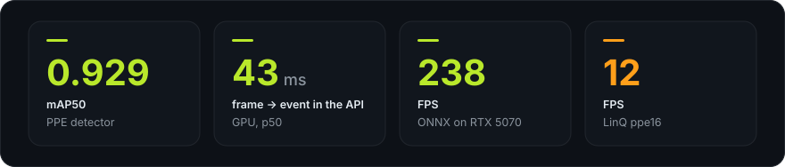
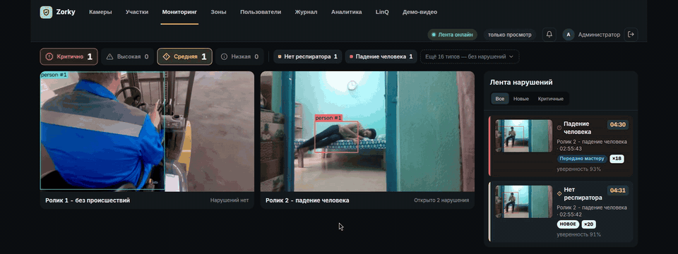
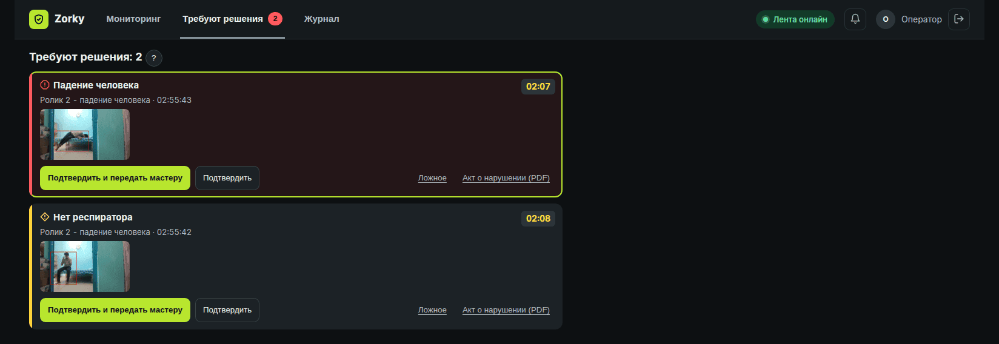
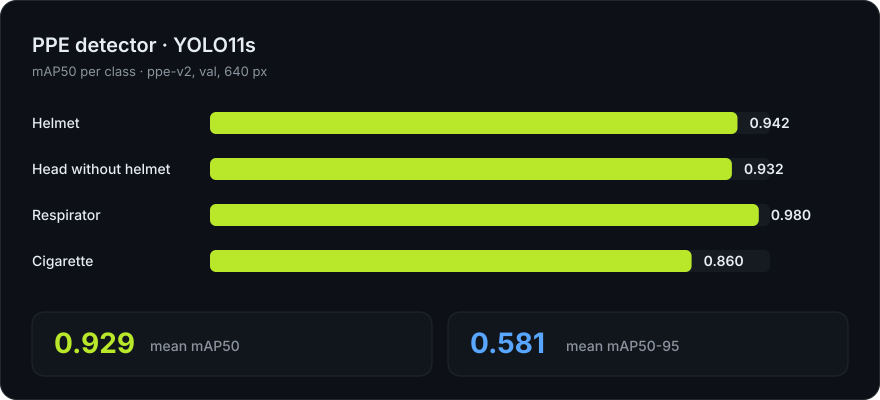
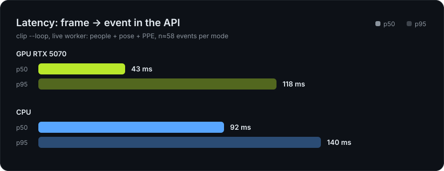
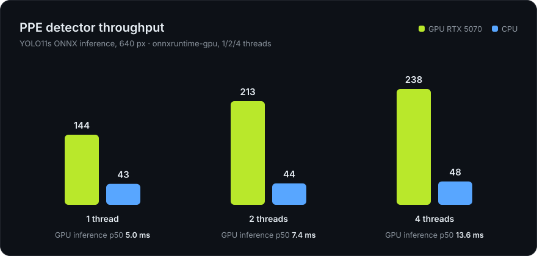
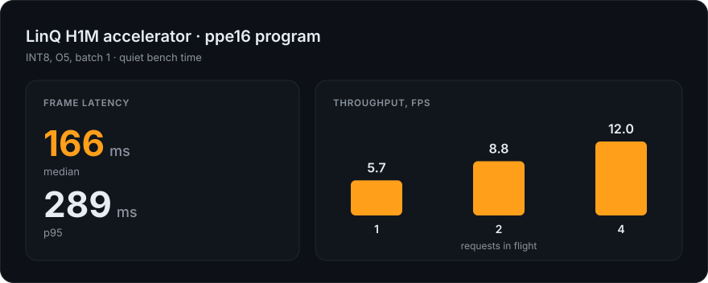
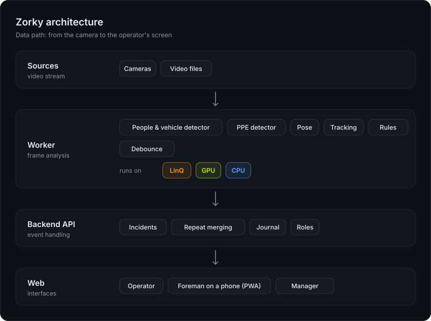

<div align="center">

# Zorky

**Video monitoring for industrial safety.**<br>
The camera sees a violation — the person in charge gets a card with the frame within seconds. One violation — one alert.<br>
<sub>Built by team Surgut at the Otkroy Mosprom hackathon (LinQ case).</sub>



<br>



</div>

<br>

## What it is

Zorky analyzes video streams from cameras and detects dangerous behavior: a person without a helmet or respirator, smoking, falls, entering a restricted zone. The neural network runs on the **LinQ** AI accelerator, on a GPU or on a CPU. Video and the event log stay inside the company's network perimeter — no cloud services.

|  |  |
|---|---|
| **One violation — one alert** | While the person is in the frame, a “×N” counter grows on a single card. No duplicates. |
| **Critical events go out automatically** | Falls and immobility go to the foreman without the operator. Escalation if the foreman doesn't respond. |
| **The foreman's pocket app** | A card with the frame on the phone, a response timer, “Got it, on my way”. No app store needed. |
| **Zones on the frame** | A polygon is drawn by clicking right on the picture; rules are set per area, camera and schedule. |
| **Evidence** | An event log with filters, CSV export and a PDF violation report. |
| **Analytics** | Hours, shifts, cameras, zones, response time and a heat map on the frame. |

<br>

## For every role

The **operator** works through the “Needs review” queue: a frame with the person highlighted, three actions, keyboard shortcuts (`J`/`K`, `1`, `3`), five false-alarm reasons.

<p align="center"></p>

The **foreman** opens the `/master` page on a phone: a red banner for a critical case, the frame, a response timer, sound and vibration, a “Got it, on my way” button. The app installs to the home screen, no app store needed.

<p align="center"></p>

The **safety officer** configures area and camera rules, schedules and zones without programmers. The **manager and auditor** get read-only access to the event log and analytics. The **administrator** manages users, cameras and the inference device.

<p align="center"></p>

<br>

## Numbers

Measured on the project's own build. Raw figures — [`docs/measured.json`](docs/measured.json).









<br>

## Architecture



Backend layers: `domain` → `application` → `infrastructure` → `api`. Dependencies point inward. The data exchanged between zones is described by the contract in [`contracts/`](contracts/): the event JSON schema and OpenAPI. A new violation type is a separate rule module; the rest of the system doesn't change.

Project components (the code itself is not published in this repository):

```
backend/     API, repeat merging, event log, roles (FastAPI, SQLite)
ml/          worker: detectors, tracking, rules; training and evaluation
web/         operator, foreman and manager interface (React, PWA)
linq/        connection to and measurements on the LinQ accelerator
contracts/   event schema and OpenAPI — the single source of truth
```

<br>

## Availability

This repository is a showcase of the project: documentation, architecture, measurements, screenshots and the public API contract in [`contracts/`](contracts/). The source code, model weights and deployment tooling are not published here. The user guide by role: [`docs/Zorky_user_guide.pdf`](docs/Zorky_user_guide.pdf).

For questions about use, integration or licensing, please get in touch through the GitHub profile of the repository owner.

<br>

<div align="center">

**Zorky** · one person in the frame — one violation — one alert

</div>
